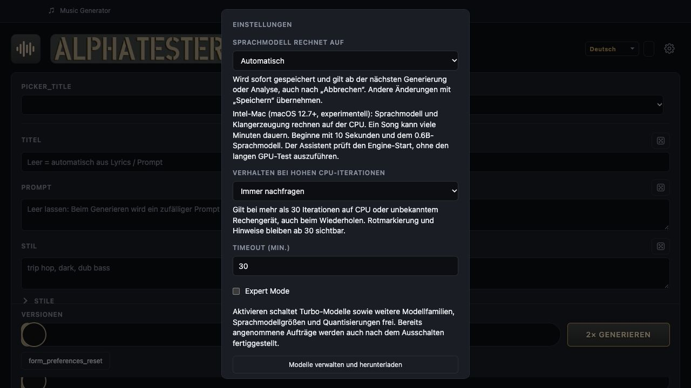

# macOS 12.7 auf Intel testen

Die Unterstützung ist **experimentell**. Dieser Kandidat erweitert das Intel-CPU-Paket auf macOS 12.7. Die automatisierten Paketprüfungen laufen auf macOS 15; ein erfolgreicher Build bestätigt noch keine tatsächliche Musikgenerierung oder vollständige GUI-/Audio-Kompatibilität unter Monterey. Apple Silicon verwendet weiterhin das separate Paket ab macOS 14.

## Testpaket

Im zugehörigen Pull Request unter **Test builds** das Artefakt **macOS Intel / x64** der dort angegebenen Quellcode-Revision herunterladen. Das GitHub-Artefakt ist ein ZIP mit DMG, App-ZIP und Prüfsummen. Es ist ein zeitlich verfügbarer CI-Testdownload, kein veröffentlichter Release. Ältere Release-Pakete mit Mindestversion 13.3 funktionieren dadurch nicht nachträglich unter 12.7.

Für den Test einen Intel-Mac mit macOS 12.7 und installierten Safari-/WebKit-Systemupdates verwenden. macOS-Unterversion, Mac-Modell und RAM notieren. Bei vorhandener Bibliothek vor dem Test die App schließen und den Datenordner sowie separat gewählte Song-Ordner sichern; die Pfade stehen unter [Daten und Updates](../../desktop.md#data-and-updates).

## Kurzer Funktionstest

1. DMG öffnen, die App in einen beschreibbaren Ordner kopieren, das DMG auswerfen und die Kopie starten. Prüfen, ob Startfenster und anschließend Assistent oder Studio erscheinen. Die Testausgabe ist nicht mit einer Developer-ID notarisiert; Betriebssystem-Warnungen sind möglich.
2. Im Assistenten das **0.6B-Sprachmodell** und das **Standard-Klangmodell** wählen. Für Modelle und Songs testweise externe Ordner über die nativen Auswahldialoge freigeben. Downloads, Prüfsummenprüfung und Engine-Start abschließen. Der Intel-Assistent überspringt den GPU-Test.
3. Die App vollständig beenden und erneut öffnen. Prüfen, ob Modell- und Song-Ordner weiter zugänglich sind und die gespeicherten Einstellungen erhalten bleiben. In den Einstellungen sollte der experimentelle Intel-/macOS-12.7-Hinweis sichtbar sein.
4. Einen instrumentalen Song mit **10 Sekunden**, **einer Version** und **höchstens 30 Iterationen** erzeugen. Den Titel leer lassen, um anschließend auch die lokale Titel-Engine zu testen. Prompt, Iterationen und die benötigte Zeit notieren. CPU-Generierung kann viele Minuten dauern; das für Monterey deaktivierte BLAS-Backend kann die Berechnung zusätzlich verlangsamen.
5. Den fertigen Song abspielen, pausieren und im Player spulen. Auf hörbares Audio und eine plausible gemessene Dauer achten. Den Song als **WAV** und **MP3** exportieren, bei Bedarf das Exportformat in den Einstellungen wechseln. Beide Dateien auch außerhalb der App abspielen.
6. Einen **ZIP-Export** erzeugen, entpacken und die enthaltene Audiodatei abspielen. Die App erneut starten und prüfen, ob der Song in der Bibliothek bleibt und wieder abgespielt werden kann.

## Testergebnis zurückmelden

Im PR die verwendete Quellcode-Revision, genaue macOS-Version, Mac-Modell, RAM und das Ergebnis jedes Schritts angeben. Bei Fehlern den betroffenen Schritt und die sichtbare Meldung nennen; relevante Ausschnitte aus `desktop.log` und `ace-server.log` helfen bei der Diagnose. Die Protokolle liegen unter `logs/` im [Datenordner](../../desktop.md#data-and-updates). Vor dem Teilen persönliche Pfade, Prompts oder Lyrics prüfen und bei Bedarf entfernen.

Dieses Dokument enthält Testschritte, noch keine erfolgreiche Laufzeitabnahme unter macOS 12.7.

## Oberfläche

Browser-Vorschau der implementierten Einstellungen mit einer simulierten Intel-
Backendantwort. Der Screenshot belegt die Kennzeichnung, keine Ausführung unter macOS 12.7.
